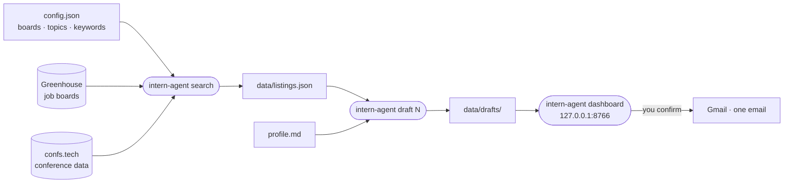

<div align="center">

# ↗ Intern Agent

**Find your next role and what comes after it.**

Search public job boards and developer conferences, turn a listing into a first draft written from your own background, and send it yourself after you've read it.

[](https://www.python.org/downloads/)
[](LICENSE)
[](#-privacy)
[](#2-add-your-background-and-an-openai-key)

[**Quick start**](#-quick-start) · [**Walkthrough**](docs/WALKTHROUGH.md) · [**Full video**](docs/media/walkthrough.mp4) · [**Gmail sending**](#-optional-gmail-sending) · [**Privacy**](#-privacy)

<br>

[](docs/media/walkthrough.mp4)

<sub>Recorded on a Linux server with fictional listings and fixture AI output. The CLI and dashboard are real. No email is sent in the demo.</sub>

</div>

---

## ✨ Features

<table>
<tr>
<td width="33%" valign="top">

### 🔎 Discover
Pull open roles from the **Greenhouse** boards of companies you pick, plus upcoming **conferences and calls for speakers** from confs.tech. One command refreshes both.

</td>
<td width="33%" valign="top">

### ✍️ Draft
Choose a listing and get an **email and a short message** written from your `profile.md`. The output is structured and validated, then saved locally for you to edit.

</td>
<td width="33%" valign="top">

### 📬 Send, optionally
Review drafts on a **local dashboard**. With Gmail connected, you check the recipient yourself and send **one email per click**. Nothing goes out automatically.

</td>
</tr>
</table>

> [!NOTE]
> Intern Agent never applies to jobs or sends email on its own. Every message is a draft until you read it and click **Send one email**.

## ⚙️ How it works



## 🚀 Quick start

### 1. Install

Requires **Python 3.12+**.

<details open>
<summary><b>macOS / Linux</b></summary>

```bash
git clone https://github.com/aaravhmodi/agent-intern.git
cd agent-intern
python -m venv .venv
source .venv/bin/activate
python -m pip install -e .
cp config.example.json config.json
cp profile.example.md profile.md
```

</details>

<details>
<summary><b>Windows PowerShell</b></summary>

```powershell
git clone https://github.com/aaravhmodi/agent-intern.git
Set-Location agent-intern
py -3.12 -m venv .venv
.\.venv\Scripts\python.exe -m pip install -e .
Copy-Item config.example.json config.json
Copy-Item profile.example.md profile.md
```

On Windows, use `.\.venv\Scripts\intern-agent.exe` wherever the commands below say `intern-agent`.

</details>

### 2. Add your background and an OpenAI key

Write your own factual background in `profile.md`. To generate drafts, create an [OpenAI API key](https://platform.openai.com/api-keys) and add it to a local `.env` file:

```bash
cp .env.example .env                 # PowerShell: Copy-Item .env.example .env
```

```dotenv
OPENAI_API_KEY=sk-...
```

`intern-agent` reads `.env` from the folder you run it in. Values already set in your shell take priority. Git ignores `.env`, `profile.md`, and `config.json`. You only need the key for `draft`.

### 3. Run it

```bash
intern-agent search                  # refresh every configured source
intern-agent list                    # numbered listings with source links
intern-agent list --query engineer   # filter by title, organization, or location
intern-agent draft 1                 # write a draft for listing #1
intern-agent dashboard               # review drafts at http://127.0.0.1:8766
```

> [!TIP]
> Listing numbers come from the full `intern-agent list`, not a filtered view.

## 🧭 Configuration

`config.json` controls what gets searched:

| Key | What it does | Example |
| --- | --- | --- |
| `greenhouse_boards` | [Board tokens](https://support.greenhouse.io/hc/en-us/articles/5888210160155-Find-your-job-board-URL) of companies to follow. A board URL ending in `/example` has the token `example`. | `["example"]` |
| `conference_topics` | Topic filenames from [confs.tech conference-data](https://github.com/tech-conferences/conference-data). | `["python", "javascript"]` |
| `keywords` | Optional filter for both jobs and events. Leave it empty to keep everything. | `["intern", "co-op"]` |
| `model` | OpenAI model used for drafts. | `"gpt-4o-mini"` |

> [!IMPORTANT]
> The sample config has no boards. Add at least one to `greenhouse_boards` to find jobs. To focus on internships, add words like `intern` or `co-op` to `keywords`.

**Where things are saved:** validated listings go to `data/listings.json`, and each listing keeps its public source URL. Drafts go to `data/drafts/`. If a later refresh of a source fails, your older listings are kept, so check the original page before you act on one.

## 📬 Optional Gmail sending

Search and drafts work without Gmail. To send from the dashboard:

1. Turn on [2-Step Verification](https://support.google.com/accounts/answer/185839) and create a [Google App Password](https://support.google.com/mail/answer/185833). Some work, school, and Advanced Protection accounts may not offer app passwords.
2. Add your Gmail address and the **app password**, not your normal Google password, to `.env`:

   ```dotenv
   GMAIL_ADDRESS=you@gmail.com
   GMAIL_APP_PASSWORD=your-app-password
   ```

3. Run `intern-agent dashboard` and review a draft. Enter the recipient, check the confirmation box, and click **Send one email**.

> [!WARNING]
> Keep credentials in `.env` or your shell. Never put them in `config.json` or commit them to Git.

**Safeguards:**
- The dashboard listens only on `127.0.0.1`.
- It sends through [Gmail SMTP over SSL on port 465](https://developers.google.com/workspace/gmail/imap/imap-smtp).
- The same draft can't go to the same address twice.
- The time of each send is logged in `data/sent.json`. The app never reads your inbox.

If Gmail isn't available, copy the draft into your mail client by hand.

## 🔒 Privacy

| Data | Where it goes |
| --- | --- |
| Profile, listings, drafts, send log | Local files that Git ignores |
| Job listings | Fetched from the [Greenhouse Job Board API](https://docs.greenhouse.io/job-board) with unauthenticated GET requests |
| Conferences | Public JSON from [confs.tech](https://github.com/tech-conferences/conference-data) |
| The selected listing and your profile | Sent to your configured OpenAI model, only when you run `draft` ([Structured Outputs](https://developers.openai.com/api/docs/guides/structured-outputs)) |

## 🗂️ Project layout

```text
src/opportunity_lite/
├── cli.py         # search · list · draft · dashboard
├── sources.py     # Greenhouse and confs.tech fetchers
├── store.py       # local listings file
├── drafting.py    # OpenAI structured drafts
├── dashboard.py   # local review page
├── mailer.py      # Gmail SMTP sending
└── leads/         # send checks and duplicate prevention
scripts/demo/      # reproducible demo recording (Docker + Playwright)
```

## 🤝 Contributing

Issues and pull requests are welcome. Run the tests before you open a PR:

```bash
python -m pip install -e ".[dev]"
python -m pytest
```

To record the demo video again, see [docs/WALKTHROUGH.md](docs/WALKTHROUGH.md#reproduce-the-recording).

## 📄 License

[MIT](LICENSE). Run it, adapt it, and contribute back.

<div align="center">
<br>
<sub>If Intern Agent helps you land something, a ⭐ helps other people find it.</sub>
</div>
